# LocateNet

<p align="center">


```

  _     ___   ____    _  _____ _____   _   _ _____ _____ 
 | |   / _ \ / ___|  / \|_   _| ____| | \ | | ____|_   _|
 | |  | | | | |     / _ \ | | |  _|   |  \| |  _|   | |  
 | |__| |_| | |___ / ___ \| | | |___  | |\  | |___  | |  
 |_____\___/ \____/_/   \_\_| |_____| |_| \_|_____| |_|  
                                                         

```

</p>


<p align="center">

[](https://github.com/faizdevx/LocateNet/actions/workflows/ci.yml)


</p>


LocateNet is a face-matching assistant for missing-person cases.
Officers enrol a reference photo of a missing person. The public can upload sighting photos
(or videos). The system detects every face, compares each one with the enrolled faces, and shows
likely matches to the responsible officer, who must confirm or reject each one.

**A match is a lead for a human to review, never an identification.** See
[Limitations & Responsible Use](#limitations--responsible-use).

---

## Features

- Detects and extracts multiple faces from group photos (and, optionally, video)
- Generates 512-dimension face embeddings with InsightFace (ArcFace)
- Similarity search using FAISS vector indexing, inspecting the top 5 neighbours per face
- Similarity tiers ("High Similarity", "Possible Match – Needs Review") with a configurable threshold
- Officer review screen with a face gallery and Confirm / False Positive / Ignore decisions
- Hotspot alert when the same case is matched repeatedly in one city (see below)

---

## System Architecture

| Layer | Component | Description |
|------|------|------|
| Vision | InsightFace (buffalo_l) | Face detection, alignment, and embedding extraction |
| Vector Search | FAISS | Cosine similarity search over active (not yet found) cases |
| Backend | Flask + SQLite | Routes, sessions, CSRF protection and relational storage (`sqlite3`) |
| Video (optional) | YOLOv8 + DeepSORT | Person detection and tracking before face matching |
| Mapping | Folium / Geopy | Map of cases per city, using coordinates stored at registration |

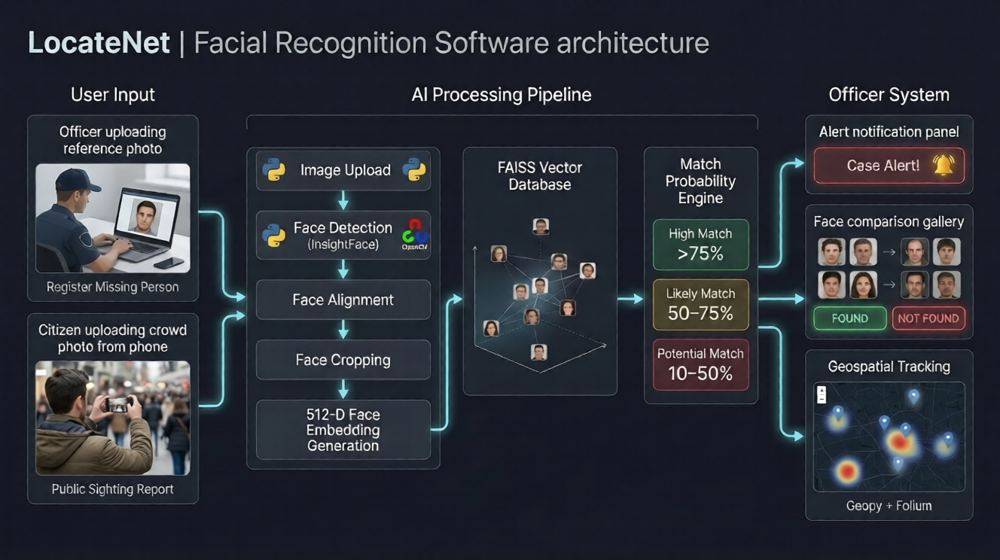 

Body re-identification is **not** part of the working system. A placeholder exists behind
`ENABLE_REID` (off by default); it uses an untrained projection head and is not a valid ReID model.

---

## Project Structure

```
LocateNet
│
├── app.py                  Flask app and routes
├── config.py               Thresholds and settings (environment variables)
├── models.py               SQLite schema and queries
├── init_system.py          Creates the database, admin user, ZIPNET tables and empty vector index
├── zipnet_worker.py        ZIPNET sync worker (started by app.py, or run on its own / in Docker)
├── clean_system.py         DESTRUCTIVE: wipes local data
│
├── pipeline
│   ├── detection_pipeline.py   Image pipeline
│   ├── video_pipeline.py       Video pipeline (optional extras)
│   ├── zipnet_pipeline.py      One checkpointed sync turn of one ZIPNET section
│   └── scoring.py              Shared threshold and category logic
│
├── services
│   ├── face_service.py         InsightFace wrapper
│   ├── alert_service.py        Hotspot rule
│   ├── zipnet_*.py             ZIPNET sync: adapters (field allow-lists), scraper, store, scheduler, supervisor
│   └── reid_service.py         Placeholder, disabled by default
│
├── vector_db
│   ├── search_service.py       FAISS index
│   ├── rebuild.py              Rebuild / sync the index from SQL
│   └── storage                 Index files (created at runtime)
│
├── eval                    Evaluation harness: python -m eval run <config> | report
│   ├── config                  One YAML per experiment
│   ├── datasets                LFW, RFW, WIDER FACE loaders
│   ├── protocols               verification, open-set, bias, robustness, quality, detection, latency
│   ├── results / plots         Committed metric JSON and PNG plots (no images, no embeddings)
│   └── cache                   Embedding cache (git-ignored)
├── blueprints              zipnet_sync.py: admin status/control endpoints
├── models                  calibrator.json (score -> estimated likelihood)
├── scripts                 rebuild_index.py, download_models.py, get_eval_data.py, dev.ps1
├── templates               HTML templates
├── tests                   pytest suite (tests/eval: metric and protocol tests)
├── docs                    EVALUATION.md, MODEL_CARD.md, OPERATING_POINT.md, HISTORY_CLEANUP.md
├── data                    Evaluation datasets (git-ignored)
├── samples                 Synthetic test images (see samples/README.md)
│
├── resources               Face crops and sighting media (created at runtime, git-ignored)
├── uploads                 Case photos (created at runtime, git-ignored)
└── logs                    system.log (created at runtime, git-ignored)
```

---

## WORKING 
## Application Interface

### 1. Common Interface


### 2. Admin / Officer Login
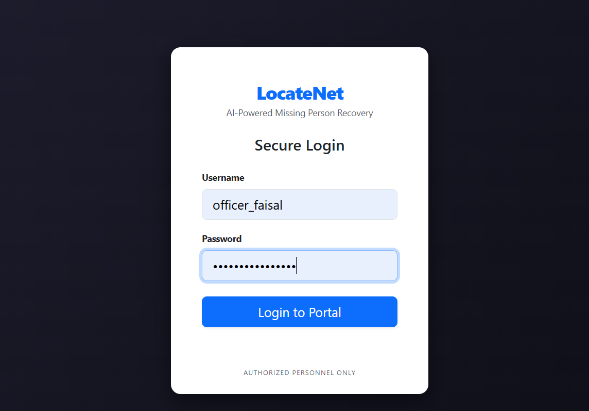

### 3. Role Based Task Dashboard
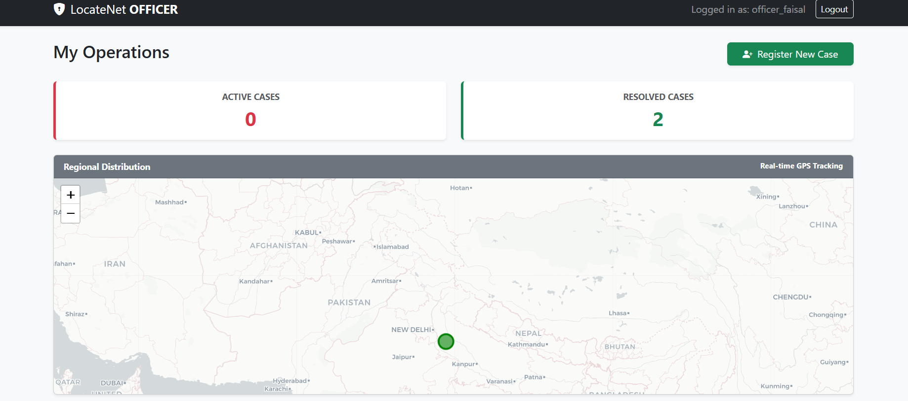

### 4. Officer Registers New Case
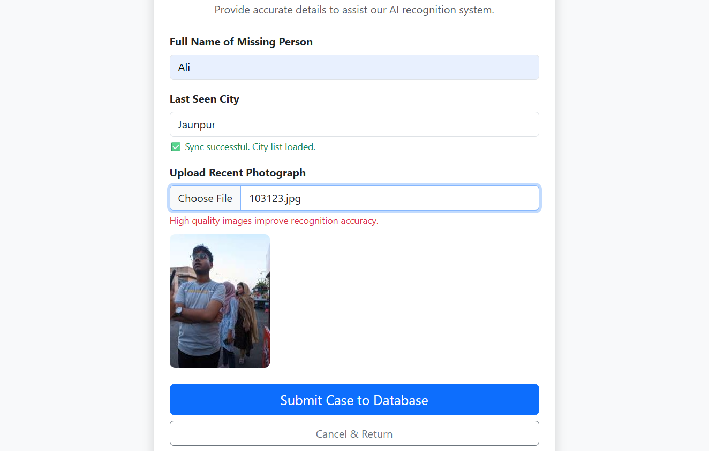

### 5. Reporting by Public / Other Officers
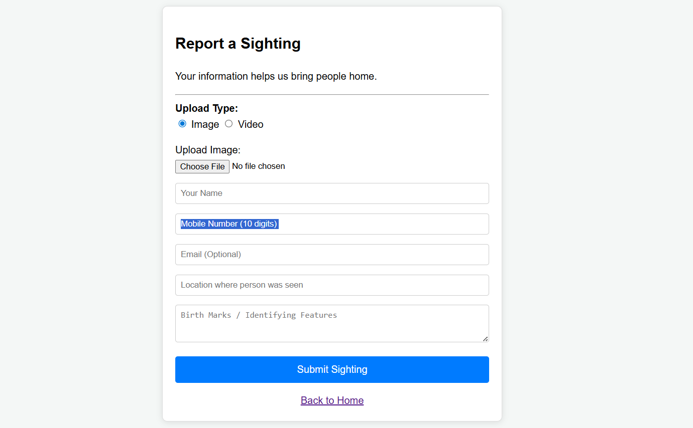

### 6. Face Match Detection Notification
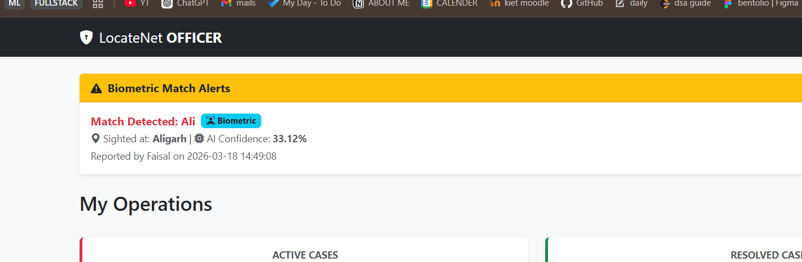

### 7. Officer Verification (Found / Not Found)
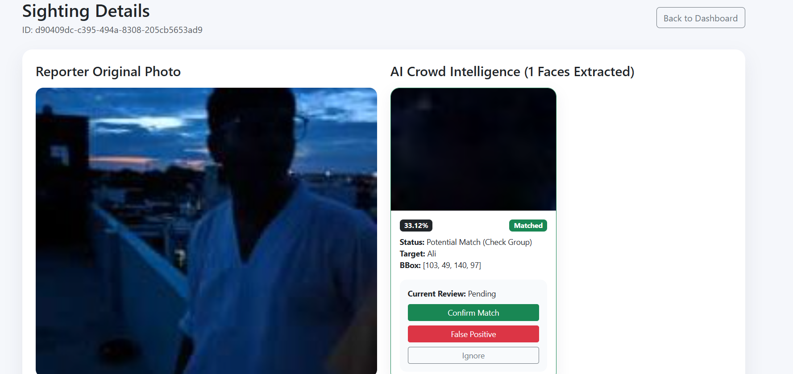

## Week 1 Upgrade (October 2026)

Correctness, security and reproducibility pass. No new features and no UI redesign.

### 1. Login (CSRF-protected form, secret key from `.env`)
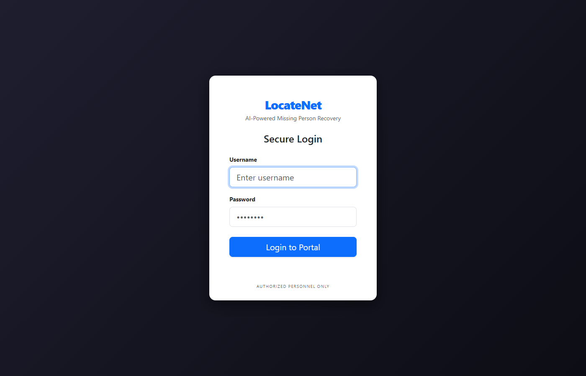

### 2. Hotspot alert: same case matched 3 times in one city within 48 hours
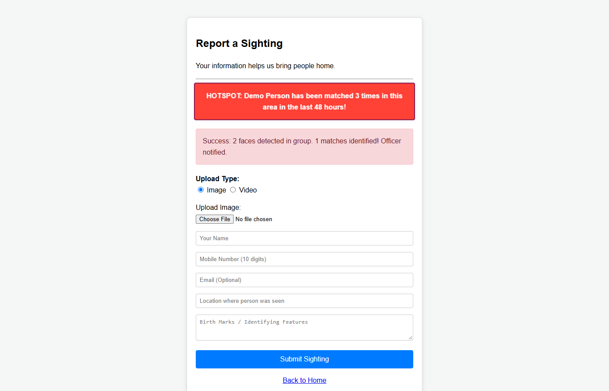

### 3. Officer alerts show raw similarity and say a human must review
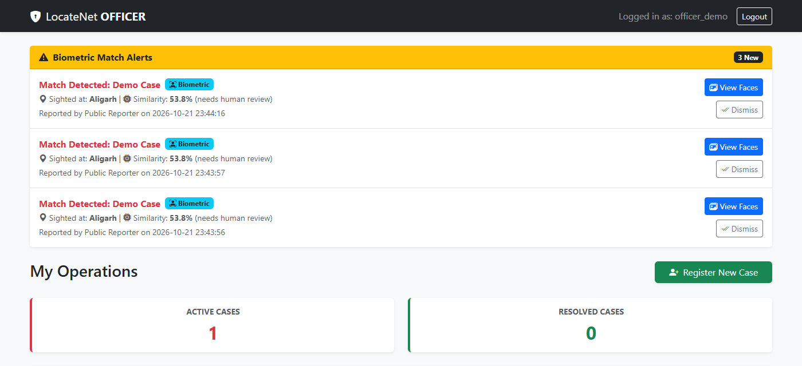

### 4. Upload validation (type and size are checked, errors are friendly)
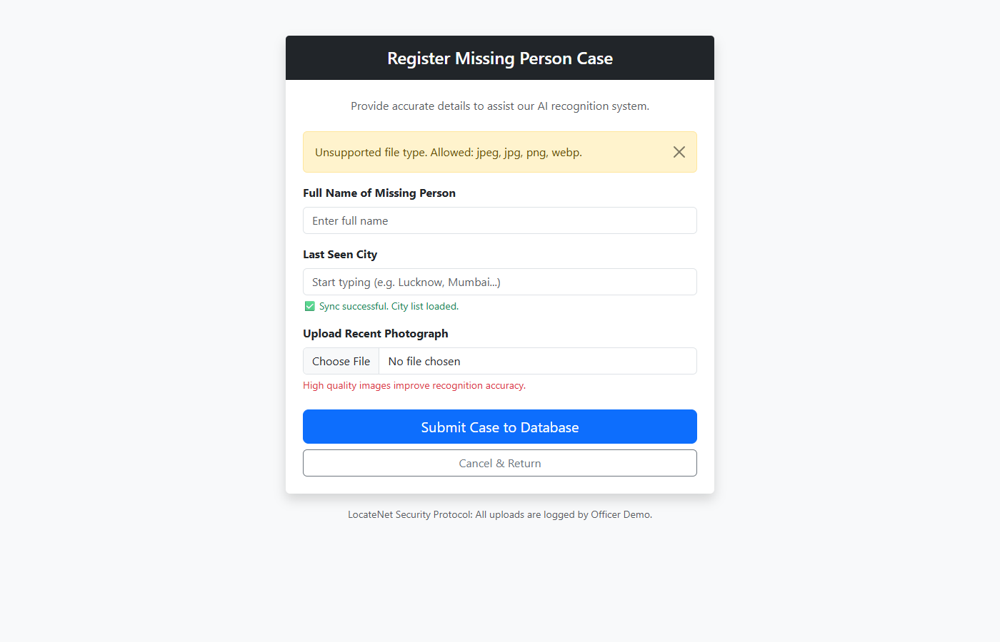

### 5. Officer review screen: possible match (53.8% similarity) with Confirm / False Positive / Ignore
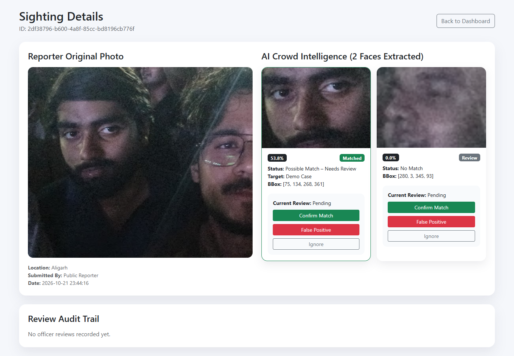

### 6. Public registry: only missing cases, with name, city, date and photo
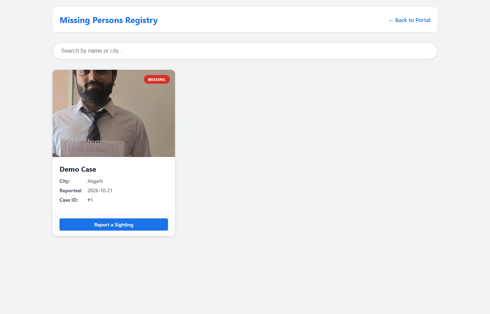

Screenshots are from a demo run with two test photos.

## Installation

Requires Python 3.11 or 3.12.

```bash
git clone https://github.com/faizdevx/LocateNet.git
cd LocateNet
python -m venv .venv
# Windows: .venv\Scripts\activate     Linux/macOS: source .venv/bin/activate
pip install -r requirements.txt
```

Optional extras:

| File | Adds |
|------|------|
| `requirements-video.txt` | Video uploads (`ultralytics`, `deep-sort-realtime`) |
| `requirements-reid.txt` | Placeholder body ReID (`torch`, `torchvision`), not recommended |
| `requirements-dev.txt` | Lightweight test and lint tools (pytest, ruff) |

Create your settings file and set a secret key:

```bash
cp .env.example .env
python -c "import secrets; print(secrets.token_hex(32))"   # paste into LOCATENET_SECRET_KEY
```

`make setup`, `make init` and `make run` wrap these steps; on Windows use `.\scripts\dev.ps1 setup|init|run`.

### System initialization

```bash
python init_system.py
```

This creates the database tables, the `admin` user and an empty FAISS index. The admin password is
taken from `LOCATENET_ADMIN_PASSWORD`; if that is not set, a random password is generated and
**printed once**. Store it straight away. There is no password-change screen yet.

Optionally pre-download the models (InsightFace `buffalo_l`, and `yolov8n.pt` for video):

```bash
python scripts/download_models.py
```

### Running

```bash
python app.py
```

`python app.py` also starts the ZIPNET sync worker in the background when `ZIPNET_SYNC_ENABLED=1`
(the default in `.env.example`). **That makes outbound HTTPS requests** to the ZIPNET portal; set it to
`0` to disable. See [ZIPNET sync](#zipnet-public-record-sync).

The app listens on http://127.0.0.1:5000. Without `LOCATENET_SECRET_KEY` it refuses to start,
unless `FLASK_DEBUG=1` is set (then it uses a random key and sessions reset on restart).
`use_reloader=False` is used so the AI model is not loaded twice.

If the FAISS index file is missing or does not match the cases in the database, the app rebuilds
it at start-up (and logs a warning). You can also run `python scripts/rebuild_index.py`.

### Docker

```bash
cp .env.example .env        # set LOCATENET_SECRET_KEY
docker compose up --build
docker compose run --rm locatenet python init_system.py
```

The image runs `gunicorn -w 1 --threads 4` (one worker because the models are memory-heavy) and
stores the database, media and vector index in named volumes. Compose also starts one
`zipnet-worker` service (the ZIPNET sync) from the same image; Gunicorn never starts it. Set the build argument
`INSTALL_VIDEO` to `"1"` in `docker-compose.yml` for video support.

### Tests

```bash
pip install -r requirements-dev.txt
ruff check .
pytest
```

The tests mock the face models, so they need no GPU, model download, insightface or torch.
`tests/eval` (metric and protocol tests) also needs `pip install -r requirements-eval.txt`.

### Evaluation

```bash
pip install -r requirements-eval.txt
python scripts/get_eval_data.py          # LFW + WIDER FACE into data/ (checksums verified)
make eval-all                            # or: python -m eval run eval/config/<experiment>.yaml
python -m eval report                    # rebuilds docs/EVALUATION.md, docs/MODEL_CARD.md, README results
```

---

## Processing Workflow

### Enrollment

1. Officer uploads a reference image
2. Face embedding (512D vector) is generated
3. Case row is saved in SQLite, then the vector is added to FAISS under the case id
   (if FAISS fails, the case row is rolled back)

### Sighting

1. Citizen uploads a group image (or a video if the extras are installed)
2. System detects all faces and stores a crop of each
3. Each face is embedded and searched against the index (top 5)

### Matching

1. The first neighbour that is at or above `MATCH_THRESHOLD` **and** belongs to a case that is still
   missing (not resolved) is the match. A resolved case at rank 1 does not hide an active case at rank 2.
2. A match creates one alert for the officer who owns the case. Faces below the threshold create nothing.
3. When an officer marks a case as found, its vector is removed from the index.

---

## Results

Measured with the evaluation harness in `eval/` on LFW (identity-disjoint tune/test splits),
WIDER FACE, FG-NET and CALFW (age gaps). LFW is easier than real sightings; read the threats to
validity in EVALUATION.md. Every change is checked with `make eval-regress` against the Week 2
baseline.

<!-- results:start -->
<!-- generated by `python -m eval report`; edit eval/report.py, not this block -->

| Metric | Value [95% CI] |
|---|---|
| LFW 1:1 accuracy (10-fold), enrolled pairs / end to end | 99.83% ± 0.20% / 99.82% ± 0.19% |
| FNIR @ FPIR=1%, gallery 1000 (test) | 0.44% [0.07%, 0.87%] |
| Rank-1 identification, gallery 1000 (test) | 99.68% [99.29%, 99.94%] |
| ECE raw (min-max) -> calibrated (platt) | 0.125 -> 0.006 |
| Worst/best group FMR ratio at pooled FMR 1e-4 (LFW fallback; Indian group too small to measure) | 9.04x (asian vs white) [5.94, 15.67] |
| FNMR, child enrolment vs 0-2 y / 21+ y age gap (FG-NET) | 2.8% / 59.2%  [52.0%, 66.7%] |
| Video aggregation vs best frame (SYNTHETIC tracks): FNIR / FAISS searches | 0.0% vs 0.0%; 265 vs 2437 searches (no accuracy gain; ID-switch split cuts misses on glued tracks from 11% to 0%) |
| Minimum usable face width | 32 px |
| p95 latency, 10-face photo (CPU, det_size 640) | 2588 ms |

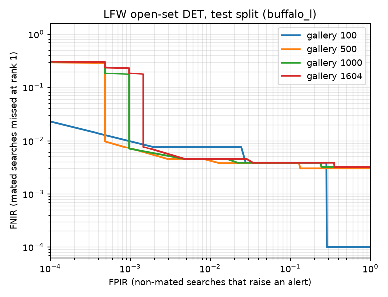 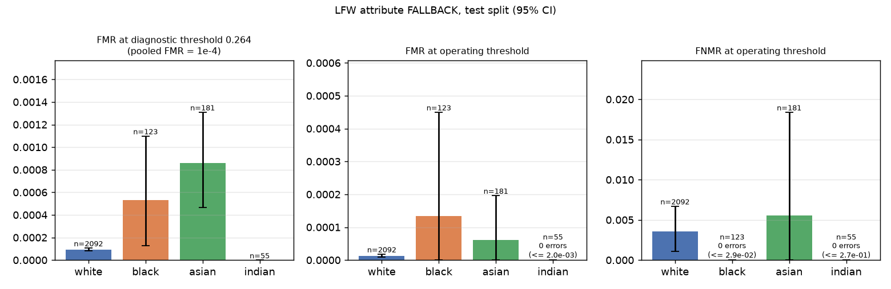

Full protocols, CIs and plots: [docs/EVALUATION.md](docs/EVALUATION.md) · [docs/MODEL_CARD.md](docs/MODEL_CARD.md) · [docs/OPERATING_POINT.md](docs/OPERATING_POINT.md)
<!-- results:end -->

---

## Match Scoring

Scores are **raw ArcFace cosine similarity, not probabilities**. The thresholds are measured: each
one is the similarity at which a target share of searches for people who are *not* enrolled would
raise an alert (FPIR), chosen on the LFW tune split and checked on a separate test split. See
[docs/OPERATING_POINT.md](docs/OPERATING_POINT.md).

| Cosine similarity | Label | What happens |
|------|------|------|
| ≥ `HIGH_CONF_THRESHOLD` (0.634, FPIR 0.1%) | High Similarity | Alert, officer reviews |
| ≥ `MATCH_THRESHOLD` (0.312, FPIR 1%) | Possible Match – Needs Review | Alert, officer reviews |
| below `MATCH_THRESHOLD` | No Match | No alert |

Officers also see an **estimated match likelihood** from a calibrator fitted on LFW
(`models/calibrator.json`). It assumes that 10% of searched faces belong to an enrolled person
(`CALIBRATION_PRIOR`); in a crowd photo the real share can be much lower, so treat it as an estimate.
Every alert still says "Needs human confirmation".

### Human in the loop

LocateNet never acts on a match by itself: every alert goes to the officer who owns the case, who
confirms it, rejects it or ignores it. Those decisions are measured on `/admin/model-health`
(precision with confidence intervals, shown only with enough reviews), can add a confirmed face
as an extra reference photo behind anti-poisoning guards, turn rejected faces into exemplars that
downgrade repeat look-alike alerts, and feed calibration *proposals* that an Admin must approve.
A 2% random sample of below-threshold faces is also reviewed, because otherwise misses would never
be seen. Details: [docs/FEEDBACK_LOOP.md](docs/FEEDBACK_LOOP.md).

Cases can have up to 5 reference photos (different ages and angles). Photos taken years ago lose
value quickly for children; the case page warns when the newest photo is old and shows the
measured miss rate for that age gap.

---

## Hotspot alert

A hotspot is raised when **the same case is matched at least 3 times in the same city within 48
hours**. "City" is the location text entered with the sighting, compared after trimming and
lower-casing. Three sightings of different people do not make a hotspot.

---

## Configuration

Settings are read from environment variables (or a `.env` file). See `.env.example`.

| Variable | Default | Meaning |
|------|------|------|
| `LOCATENET_SECRET_KEY` | none | Session signing key. Required unless `FLASK_DEBUG=1` |
| `LOCATENET_ADMIN_PASSWORD` | random | Initial admin password used by `init_system.py` |
| `FLASK_DEBUG` | `0` | Debug mode; enables a random secret key when none is set |
| `LOCATENET_DB` | `database.db` | SQLite database path |
| `MATCH_THRESHOLD` | `0.312` | Minimum cosine similarity for a match (FPIR 1%, `eval/results/operating_point.json`) |
| `HIGH_CONF_THRESHOLD` | `0.634` | Similarity for the "High Similarity" label (FPIR 0.1%) |
| `DET_SCORE_MIN` | `0.6` | Minimum face-detector score (`eval/results/quality.json`) |
| `DET_SIZE` | `640` | Detector input size; 1024 misses large close-up faces (`eval/results/detsize_check.json`) |
| `TOP_K` | `5` | Nearest neighbours inspected per face |
| `CALIBRATION_PRIOR` | `0.1` | Assumed share of searched faces that are enrolled, for the likelihood estimate |
| `LOCATENET_CALIBRATOR` | `models/calibrator.json` | Calibrator file; if missing, only raw similarity is shown |
| `ENABLE_REID` | `0` | Placeholder body ReID (not a valid ReID model) |
| `DETECT_PAD_RETRY` | `1` | Retry detection on a padded canvas when no face is found (close-up portraits) |
| `TEMPLATE_STRATEGY` | `max` | How several reference photos of a case are combined (`eval/results/multi_template.json`) |
| `MAX_PHOTOS_PER_CASE` | `5` | Reference photos per case |
| `MIN_ENROL_FACE_PX` | `32` | Smallest face width accepted for a reference photo |
| `ENABLE_RECENCY_WEIGHTING` | `0` | Up-weight recent photos (negative result, off) |
| `AGE_GAP_WARNING_YEARS` | `5` | Warn when the newest reference photo is older than this |
| `TRACK_AGG_STRATEGY` | `best_frame` | How a video track is turned into searches (`eval/results/video.json`) |
| `ENABLE_TRACK_SPLIT` / `TRACK_SPLIT_THRESHOLD` | `1` / `0.1` | Split tracks at an ID switch |
| `VIDEO_FRAME_STRIDE` | `5` | Process every n-th video frame |
| `ENABLE_NEG_SUPPRESSION` / `NEG_SUPPRESS_THRESHOLD` | `1` / `0.6` | Downgrade alerts similar to rejected faces |
| `MAX_SIGHTING_TEMPLATES` | `3` | Confirmed sighting faces that may become reference photos per case |
| `AUDIT_SAMPLE_RATE` | `0.02` | Share of below-threshold faces sent to the random QA queue |
| `RETENTION_DAYS` | `90` | Deletion age for negative exemplars, QA samples and stored face embeddings |

Uploads: images up to 10 MB (jpg, jpeg, png, webp), videos up to 100 MB (mp4, mov, avi).

---

## ZIPNET public-record sync

A background worker imports the public records of the [ZIPNET portal](https://zipnet.delhipolice.gov.in/)
(six sections, about 6.2 million records) into a **separate** SQLite file, first as a resumable historical
backfill and then as recurring incremental updates. It starts automatically with `python app.py` (or as the
`zipnet-worker` Docker service), resumes from its last committed checkpoint after any stop, and shows honest
progress to administrators at **Admin → ZIPNET sync** (`/admin/zipnet-sync`).

- Imported records are not cases: no face matching, no alerts, nothing marked found. Linking one to a case is an explicit administrator action.
- Only allow-listed fields are read; phone numbers, addresses, family details, officer contacts and religion are never stored. Photos are not copied.
- Needs outbound HTTPS to `ZIPNET_BASE_URL` (default request delay 2 s); the full backfill takes about three days. `ZIPNET_SYNC_ENABLED=0` makes no requests.
- Operate: `python zipnet_worker.py --status`, `POST /admin/zipnet-sync/start|stop`, `python zipnet_worker.py` (worker only).

### Live retrieval in action

Real-time retrieval from the live ZIPNET portal, captured from a running instance (`python app.py` with
`ZIPNET_SYNC_ENABLED=1`) a few minutes after a fresh install. The worker started by itself and fetched
5,700+ records across all six sections without blocking the web app. Each section shows its own
checkpoint ("offset N of total, not complete"), and the job table lists every committed turn. The page
refreshes every 5 seconds, so the counters grow while you watch.

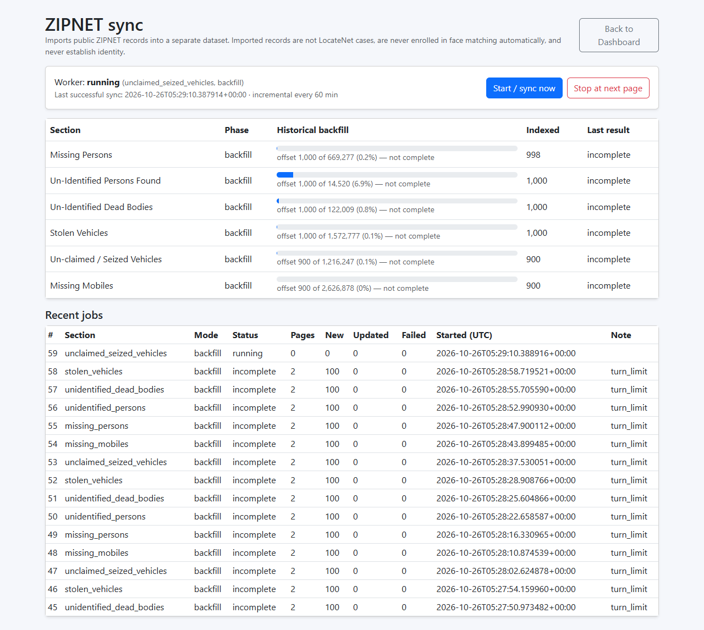

The admin dashboard links to it:

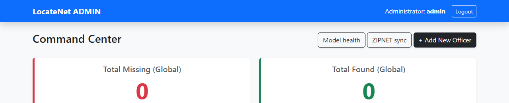

Only counts and progress are shown (no personal data). Interrupting and restarting resumes from these offsets.

Details: [docs/ZIPNET_SYNC.md](docs/ZIPNET_SYNC.md) and [docs/ZIPNET_SOURCE_INVENTORY.md](docs/ZIPNET_SOURCE_INVENTORY.md).

---

## Security

- Sessions are signed with your own secret key, cookies are `HttpOnly` and `SameSite=Lax`, and
  the session is reset on login.
- All forms carry CSRF tokens; resolving a case and dismissing an alert are POST-only.
- Officers can only dismiss alerts, review faces and resolve cases that belong to them (Admins can act on all).
- Case photos, sighting media and face crops require a login. The public registry shows only the
  name, city, date and photo of cases that are still missing.
- Resolved cases are removed from the vector index and ignored for future alerts.

---

## Limitations & Responsible Use

- **Every match needs human confirmation.** A high similarity score is not proof of identity.
  Face recognition makes mistakes, especially with poor lighting, low resolution, occlusion, age
  change and similar-looking people.
- **Evaluated on LFW only.** Thresholds, calibration and robustness were measured on LFW celebrity
  photos, which are easier than phone or CCTV sightings; expect more misses in the field. Faces
  narrower than about 32 px are unlikely to match (see [docs/EVALUATION.md](docs/EVALUATION.md)).
- **Demographic differences exist and are not fixed.** The bias audit (LFW-attribute fallback, weak
  evidence) found higher false-match rates for Asian and Black than for white identities at one
  global threshold. The Indian group, the deployment population, had too little data to measure.
  There is no child or age-gap evaluation yet.
- **Not for surveillance.** LocateNet is for locating missing people with the aim of helping them.
  Do not use it to track, profile or monitor people.
- **Personal data and retention.** The system stores face images, face embeddings, and the names,
  mobile numbers and emails of people who report sightings. There is no automatic deletion: decide
  a retention period, and delete resolved cases and unmatched sighting photos you no longer need.
  Under India's Digital Personal Data Protection Act, 2023, personal data should be collected for a
  specific lawful purpose with notice, kept only as long as needed, and protected with reasonable
  safeguards. Get legal advice before using this with real data.
- **No body re-identification.** Only faces are matched.
- Earlier versions of this repository stored real data in git history. See
  [docs/HISTORY_CLEANUP.md](docs/HISTORY_CLEANUP.md).

---

## Tech Stack

- Python 3.11 / 3.12
- Flask, Flask-WTF
- SQLite (`sqlite3`)
- InsightFace, ONNX Runtime
- FAISS
- OpenCV, NumPy
- Geopy, Folium
- Optional: Ultralytics YOLOv8, DeepSORT

---

## License

See `LICENSE` file.

---

## Author

faizdevx

---

## Full workflow walkthrough (end to end)

A real-life style example, recorded on the running application with the real models:
**Anil Verma** goes missing in Aligarh. An officer registers the case, citizens report sightings,
the system raises alerts, a human reviews and confirms, and the case is closed when he is found.

<p align="center">
  <a href="docs/walkthrough/walkthrough.mp4">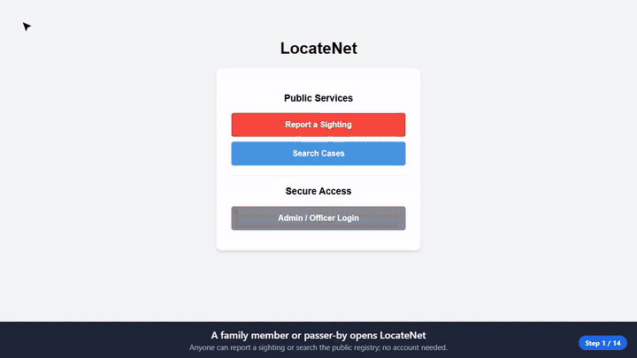</a>
  <br><em>5x speed preview. <a href="docs/walkthrough/walkthrough.mp4">Full video (2 min 24 s, mp4)</a></em>
</p>

Everything shown is fictional. The people are **synthetic faces from the open DigiFace-1M dataset**
(computer-rendered, none of them real), the names are invented, and the "CCTV" photos are collages
built for the demo. Source, licence (non-commercial research use) and credit:
[docs/walkthrough/inputs/README.md](docs/walkthrough/inputs/README.md). The red ring in every
screenshot marks the click.

### 1. A citizen opens LocateNet
No account is needed to report a sighting or search the public registry.

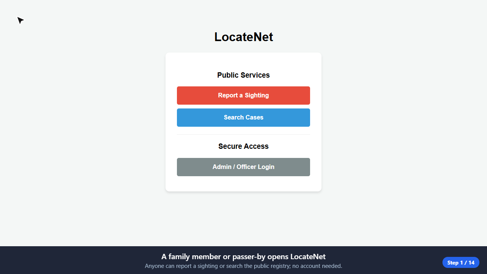

### 2. Inspector Meera Rao logs in
Hashed passwords, a fresh session on login, CSRF tokens on every form.

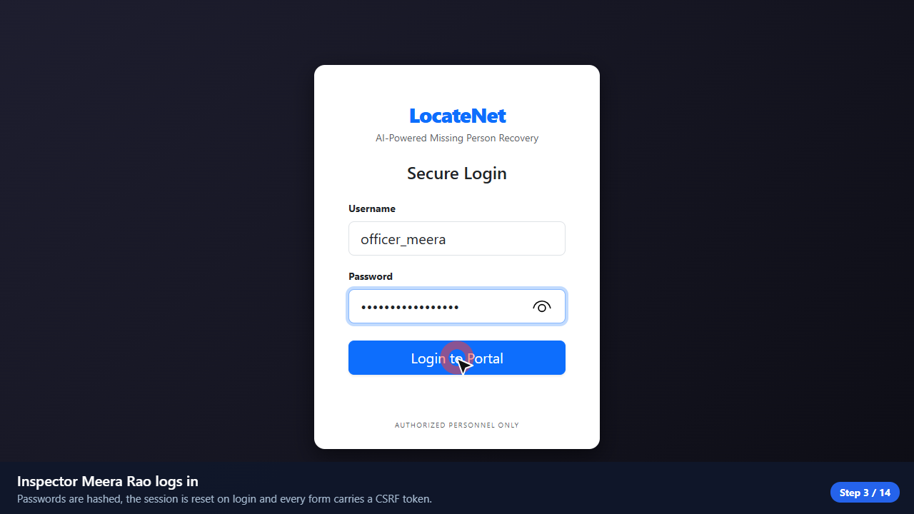

### 3. She registers a missing person
Anil Verma, last seen in Aligarh: a 2017 reference photo, date of birth and city. Each photo is quality-checked (clear, large enough face).

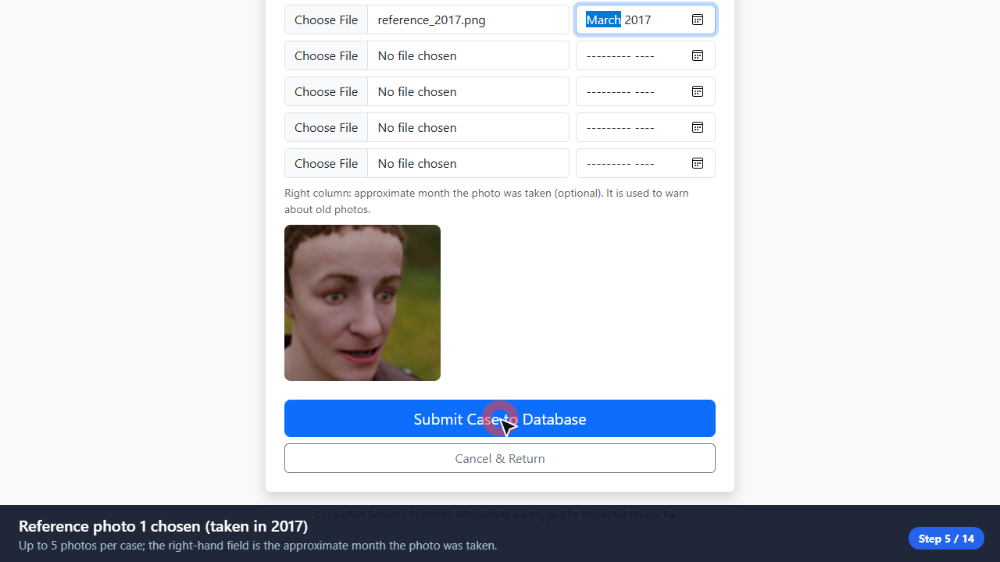

### 4. The case page warns that the photo is old
The warning and the miss rate shown come from the measured age-gap evaluation, not from a fixed number.

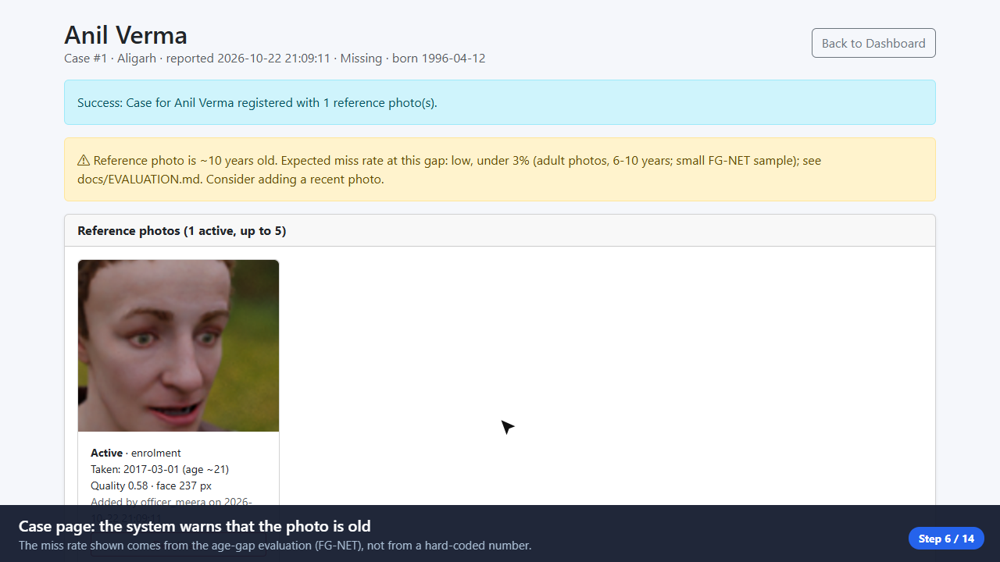

### 5. She adds a recent reference photo (2025)
Several photos from different years are the best protection against ageing. Every change goes to the audit log.

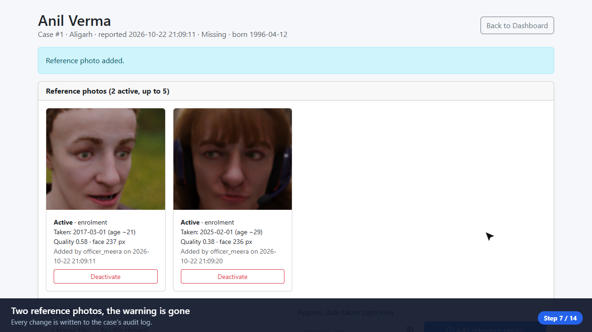

### 6. The case appears in the public registry
Only missing people, and only name, city, date and photo, are public.

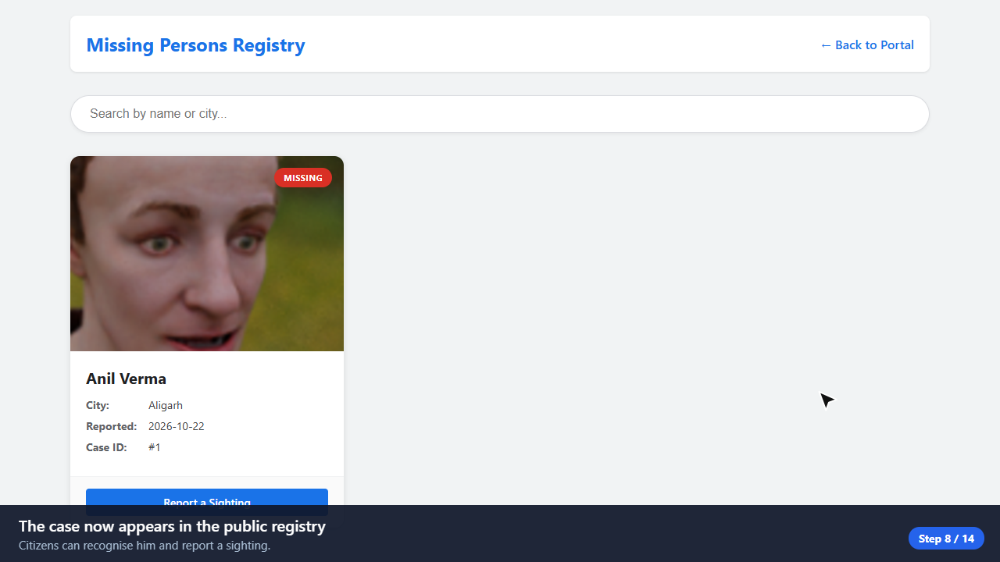

### 7. A citizen reports a sighting
Name, phone, place and a group photo (here a CCTV-style still of six people). All faces are found and compared with every open case.

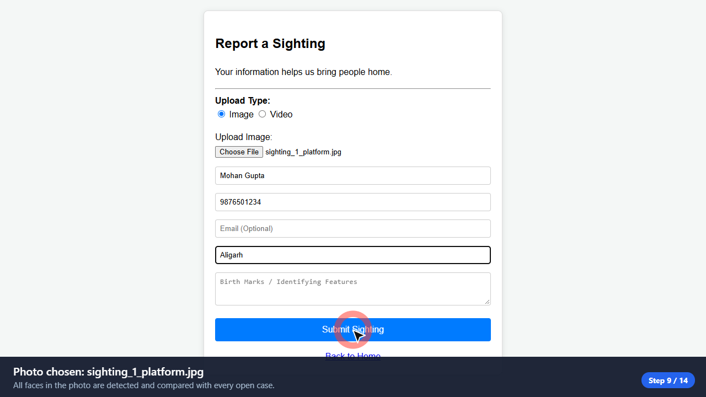

### 8. The third report raises a hotspot
The same case matched 3 times in one city within 48 hours.

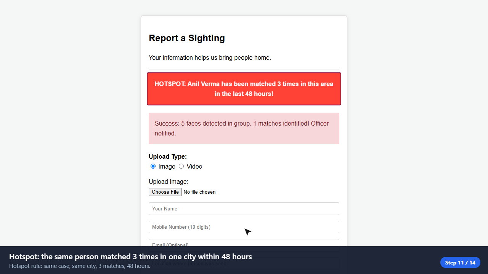

### 9. The officer sees three alerts
Raw similarity, an *estimated* match likelihood and "Needs human confirmation".

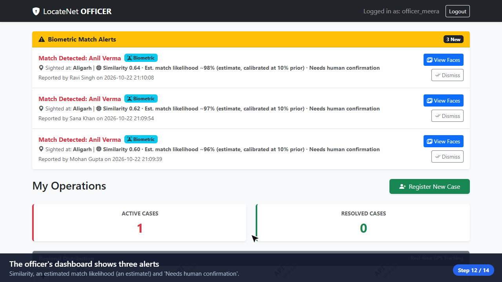

### 10. She reviews the faces
One face is a possible match; the strangers score as No Match (similarity around 0.1-0.2).

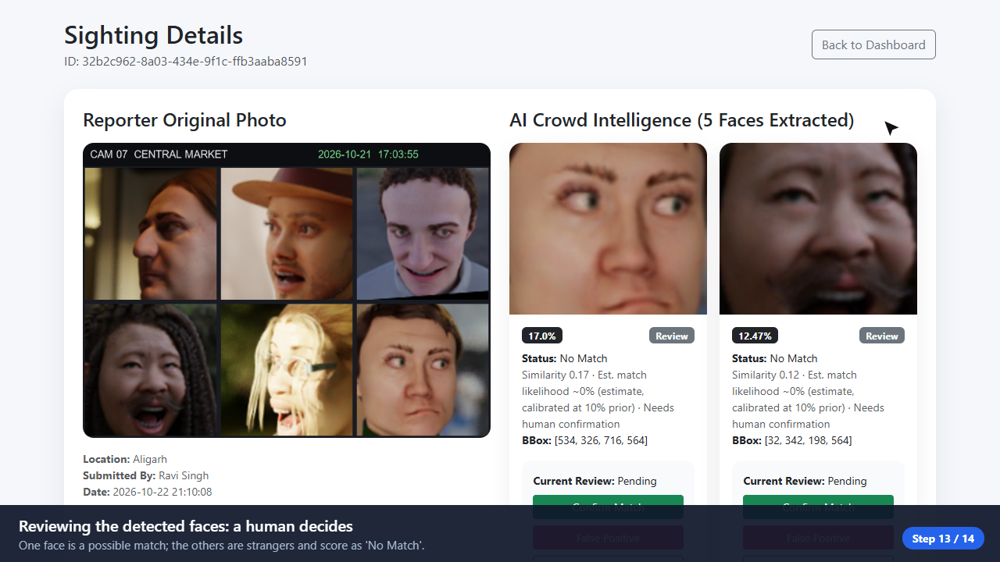

### 11. She confirms and adds the face as a reference photo
Opt-in, behind guards: only the case's officer, a quality check, and the face must resemble the enrolled photos.

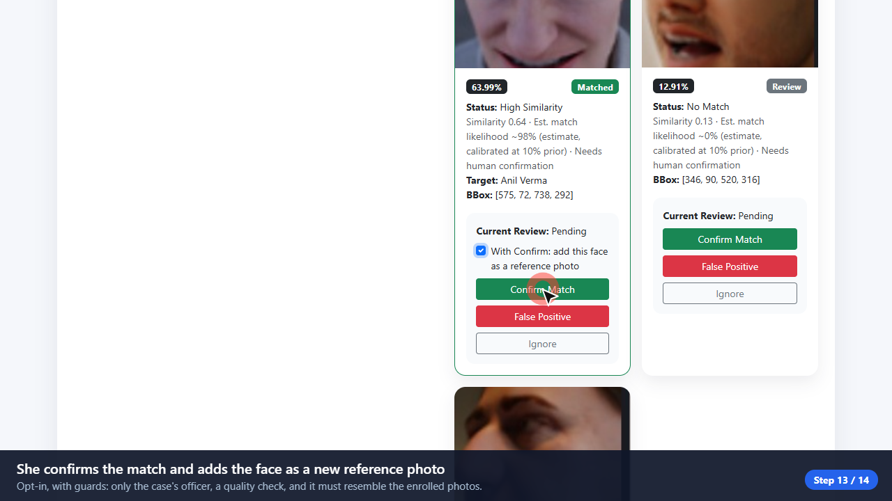

### 12. The case keeps a full audit trail
The photo from the sighting is labelled "confirmed sighting", can be deactivated, and is logged.

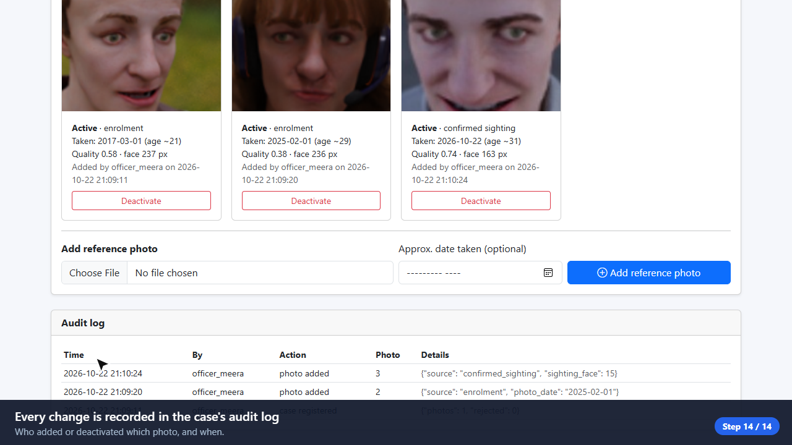

### 13. An Admin checks model health
Field precision, calibration, alert volume and review latency. With too few reviews it says "insufficient data" instead of showing a percentage.

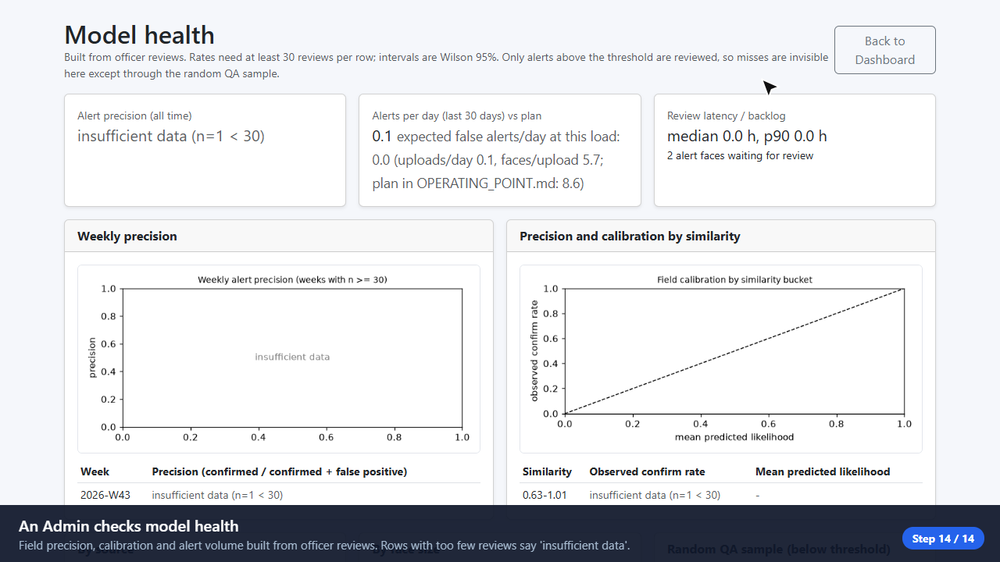

### 14. The case is closed
"Mark Found" removes the case from matching and from the public registry.

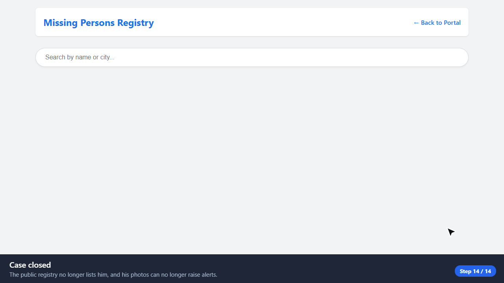

### What the example does not show
Video uploads (YOLO + tracking), the random QA sample of below-threshold faces and calibration
proposals are covered in [docs/EVALUATION.md](docs/EVALUATION.md) and
[docs/FEEDBACK_LOOP.md](docs/FEEDBACK_LOOP.md). The matches here are easy: the same synthetic
person rendered with other accessories and lighting. Real phone or CCTV photos are harder, so
expect more misses than in this demo (see the limitations above).

### Reproduce the recording

```bash
pip install playwright          # uses an installed Edge or Chrome; ffmpeg is needed for mp4/gif
export LOCATENET_DB=demo.db LOCATENET_SECRET_KEY=demo
python scripts/seed_walkthrough.py       # empty demo database + two demo accounts
python app.py                            # terminal 1
python scripts/make_walkthrough.py       # terminal 2: screenshots + walkthrough.mp4 + preview gif
```
