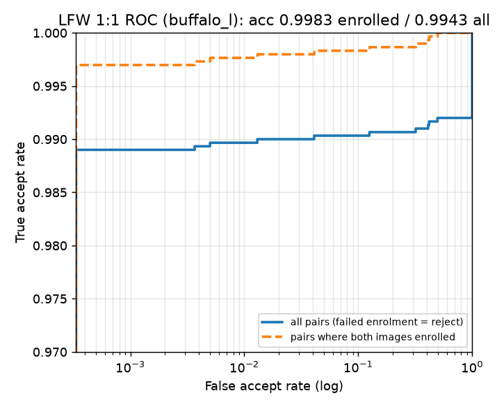
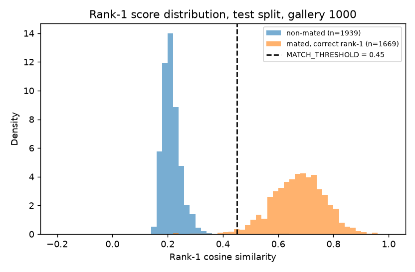
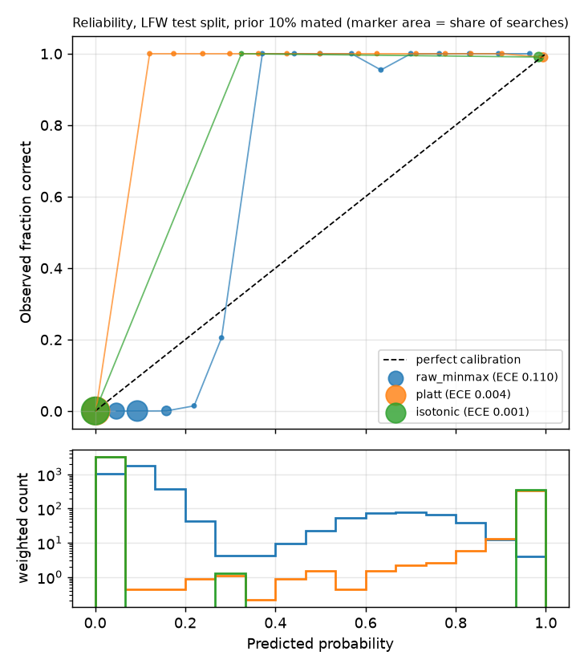
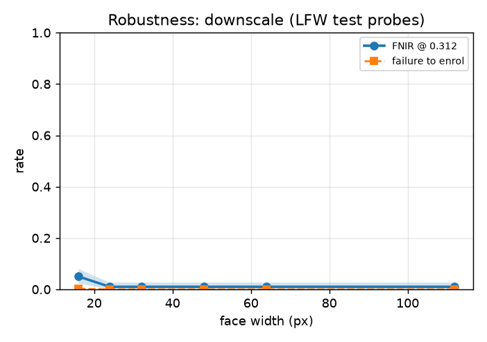
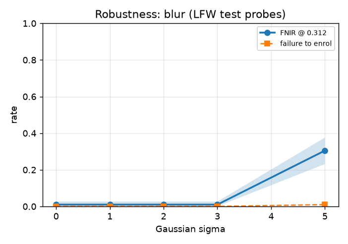
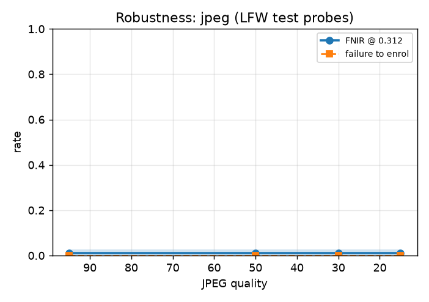
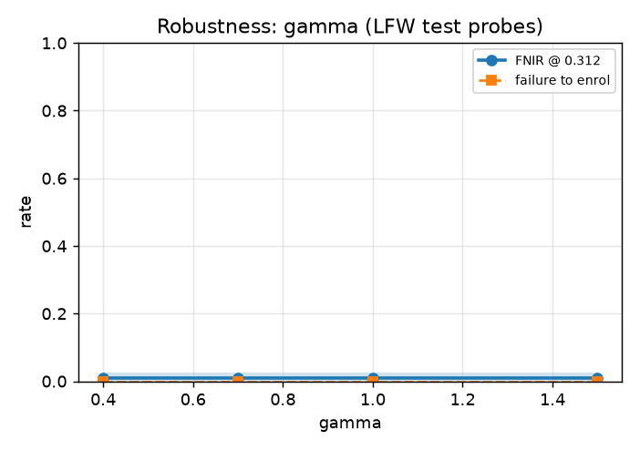
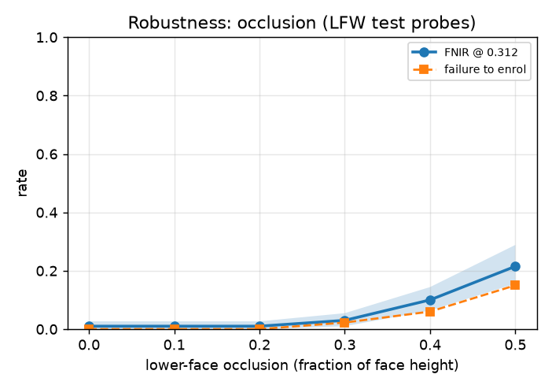
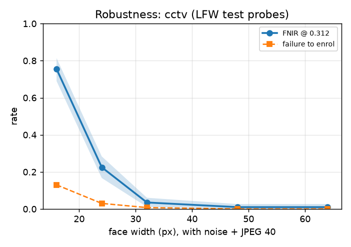
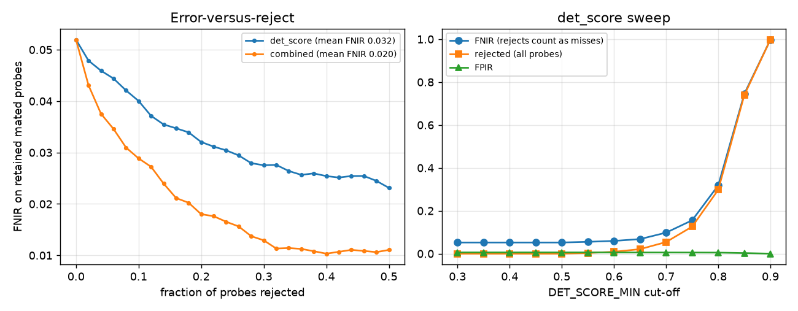

# LocateNet evaluation report

Generated by `python -m eval report` from `eval/results/*.json`. Do not edit by hand; re-run the experiments (`make eval-all`) instead.

Model: InsightFace `buffalo_l` (SCRFD-10GF detector + ArcFace ResNet-50 trained on WebFace600K), insightface 2.1, onnxruntime 1.31.0. Each result file records its git commit, dataset version and timestamp.

## Headline

| Metric | Value [95% CI] |
|---|---|
| LFW 1:1 accuracy (10-fold), enrolled pairs / end to end | 99.83% ± 0.20% / 99.43% ± 0.41% |
| FNIR @ FPIR=1%, gallery 1000 (test) | 0.60% [0.25%, 1.01%] |
| Rank-1 identification, gallery 1000 (test) | 99.58% [99.23%, 99.88%] |
| ECE raw (min-max) -> calibrated (platt) | 0.110 -> 0.004 |
| Worst/best group FMR ratio at pooled FMR 1e-4 (LFW fallback; Indian group too small to measure) | 9.26x (asian vs white) [5.49, 14.76] |
| Minimum usable face width | 32 px |
| p95 latency, 10-face photo (CPU, det_size 640) | 2588 ms |

CIs are 95% bootstrap intervals that resample identities. Scores are cosine similarities of L2-normalised embeddings; FNIR/FPIR follow the NIST FRVT 1:N definitions at rank 1.

## 1. Pipeline and data

Every image goes through the production `FaceService` (InsightFace `buffalo_l`, det_size 640, `get_quality_embedding` with `DET_SCORE_MIN`) and the same L2 normalisation as `SearchService`. When an LFW image shows several faces, the largest face nearest the centre is used (faces at least half as large as the biggest one, then closest to the centre).

- LFW images: 13233; enrolled: 13205; low quality (det_score < DET_SCORE_MIN): 10; no face found: 18.
- **Failure-to-enrol rate (FTE): 0.212%.** Failed images stay in the protocols as misses.

## 2. 1:1 verification sanity check (LFW standard protocol)

Protocol: official View 2 `pairs.txt` (10 folds x 600 pairs). For each fold the accuracy threshold is chosen on the other nine folds.

| Metric | Value |
|---|---|
| Accuracy, end to end (failed enrolment = reject) | 99.43% ± 0.41% |
| Accuracy, pairs where both images enrolled (comparable to published) | 99.83% ± 0.20% |
| Pairs containing an image that failed to enrol | 35 of 6000 |
| TAR @ FAR=0.1% | 98.90% (threshold 0.217) |
| TAR @ FAR=1% | 98.97% (threshold 0.142) |
| Distinct images in pairs.txt that failed to enrol | 20 |



Interpretation: on pairs where both images enrolled, accuracy is 99.83%, in line with the published 99.7-99.8% for buffalo_l, so alignment and embedding are wired correctly. The end-to-end figure (99.43%) is lower because the production detector (det_thresh 0.5, DET_SCORE_MIN) rejects some LFW images; published numbers use pre-aligned crops and never fail to enrol. TAR@FAR=0.1% rests on only 3 of 3000 impostor pairs and is noisy; the open-set results below are the ones that matter for the app.

## 3. Open-set 1:N identification (core experiment)

Protocol (all splits are by identity, seeded):
  * identities with >= 2 images are split 50/50 into tune and test;
    single-image identities are split 50/50 the same way.
  * inside a split, 30% of the multi-image identities are held out as non-mated; the other 70%
    form the gallery: one enrolment image each (a random image that enrolled), the rest are mated probes.
  * single-image identities of the split are divided in half: one half pads the gallery as
    distractors (gallery sizes 100/500/1000/all), the other half are extra non-mated probes.
  * probes per identity are capped (default 10, seeded) so a few heavily photographed people do
    not dominate the error rates.
  * search uses the production SearchService (FAISS IndexFlatIP + IDMap) in a temporary directory,
    top_k = config.TOP_K. Probes that failed to enrol count as misses (mated) and as no alert (non-mated).
  * CIs: 95% percentile bootstrap over identities (thresholds are re-derived in every resample).

Test split (identities never used for any threshold choice):

| Gallery | Mated / non-mated probes | FNIR @ FPIR 0.1% | FNIR @ FPIR 1% | FNIR @ FPIR 5% | Threshold @ 1% | Rank-1 | Rank-5 |
|---|---|---|---|---|---|---|---|
| 100 | 294 / 1944 | 0.68% [0.00%, 1.71%] | 0.68% [0.00%, 1.71%] | 0.68% [0.00%, 1.71%] | 0.264 [0.244, 0.279] | 99.32% [98.35%, 100.00%] | 99.32% |
| 500 | 1459 / 1944 | 0.75% [0.27%, 35.45%] | 0.55% [0.19%, 0.90%] | 0.48% [0.18%, 0.85%] | 0.298 [0.290, 0.305] | 99.66% [99.31%, 99.93%] | 99.66% |
| 1000 | 1676 / 1944 | 26.91% [0.41%, 34.71%] | 0.60% [0.25%, 1.01%] | 0.54% [0.23%, 0.90%] | 0.309 [0.302, 0.323] | 99.58% [99.23%, 99.88%] | 99.58% |
| 1602 | 1676 / 1944 | 26.91% [0.41%, 34.71%] | 0.66% [0.25%, 1.08%] | 0.54% [0.23%, 0.90%] | 0.318 [0.305, 0.327] | 99.58% [99.23%, 99.88%] | 99.58% |




At the Week 1 hand-picked threshold (0.45) and gallery 1000: FNIR 1.91%, FPIR 0.10%.

Interpretation: a larger gallery gives impostors more chances to reach rank 1, so the threshold for FPIR 1% rises from 0.264 (100 people) to 0.318 (1602 people). On LFW the genuine scores sit far above it, so FNIR stays about the same (0.68% vs 0.66%). At gallery 1000 the misses split into: right person at rank 1 but below threshold 0.18%, wrong person at rank 1 0.18%, probe failed to enrol 0.24% (each as a share of all mated searches).

At FPIR 0.1% the picture changes: FNIR jumps to 26.91% at gallery 1000, because that threshold is set by the two or three highest non-mated scores, which are not ordinary impostors (see 'Label noise and look-alikes' below). With about 1,900 non-mated searches, FPIR 0.1% is not a stable operating point on LFW.

## 4. Operating point

Chosen on the tune split: **MATCH_THRESHOLD = 0.312** (FPIR 1.0%), **HIGH_CONF_THRESHOLD = 0.634** (FPIR 0.1%). Full table, alert-load model and reasoning: [OPERATING_POINT.md](OPERATING_POINT.md).

## 5. Score calibration

Rank-1 cosine -> P(correct mated match), fitted on the tune split (gallery 1000), evaluated on the test split (1672 mated / 1939 non-mated searches), both re-weighted to a **10% mated prior**.

| Method | ECE (test) | Brier (test) |
|---|---|---|
| raw_minmax | 0.1096 | 0.0207 |
| platt | 0.0037 | 0.0022 |
| isotonic | 0.0010 | 0.0014 |



Chosen: **platt** (platt unless isotonic ECE is lower by more than 0.005), exported as plain JSON to `models/calibrator.json`. Example outputs: 0.30 -> 1%, 0.40 -> 18%, 0.50 -> 80%, 0.60 -> 99%, 0.70 -> 100%.

Interpretation: LFW scores are so well separated that only 1.04% of searches (n=161) get a predicted probability between 5% and 95%, which is why every ECE is small. In that middle range the calibrator predicts 71% on average while 91% were in fact correct, so it is conservative there. Raw min-max scores are badly calibrated (they spread non-mated searches over 0-0.3 and are over-confident).

**Base-rate caveat.** The probability is only valid when about 10% of searched faces really belong to an enrolled person. In a crowd photo most faces are strangers, so the true prior may be much lower, and the probability for the same score drops. To re-target prior pi' from the fitting prior pi: odds' = odds x (pi'/(1-pi')) / (pi/(1-pi)). The prior is `CALIBRATION_PRIOR` in `config.py`.

## 6. Demographic bias audit

> **Fallback, weaker evidence.** RFW was not available (it needs a licence request). Groups come from the Kumar et al. LFW attribute classifier scores, which are noisy; LFW is mostly white and male; some groups have very few identities. Treat these numbers as a smoke alarm, not a verdict.

Group rule: race = argmax of mean Asian/White/Black/Indian attribute score per identity (unknown if that max <= min_margin); gender = sign of mean Male score.

Views, all on the LFW **test** split only (the threshold came from the tune split):
  * 1:1 within-group: FNMR on genuine pairs (up to 10 per person) and FMR on ALL impostor pairs of
    two different people of the same group (first enrolled image of each), at the global
    MATCH_THRESHOLD. Because FMR at that threshold is close to zero everywhere, we also report a
    diagnostic FMR at the stricter-tail threshold where the pooled FMR is 1e-4, and impostor
    score tails (99th / 99.9th percentile, max), which show differences even when errors are rare.
  * open-set (Task 3 protocol, gallery 1000): per group FPIR and FNIR at the global threshold.
CIs: 95% bootstrap over identities. Disparity = max/min across groups; groups with zero errors get
a rule-of-three 95% upper bound (3/n) instead of a point ratio.

Operating threshold 0.312 (from `eval/results/operating_point.json`); diagnostic threshold 0.264 (pooled impostor FMR = 0.0001).

| Group | Identities | Genuine / impostor pairs | FMR @ operating | FMR @ diagnostic | FNMR @ operating | Impostor p99.9 / max |
|---|---|---|---|---|---|---|
| white | 2092 | 2820 / 2,187,186 | 1.3e-05 | 9.3e-05 [8.0e-05, 1.1e-04] | 0.35% [0.11%, 0.67%] | 0.205 / 1.000 |
| black | 123 | 105 / 7,503 | 1.3e-04 | 5.3e-04 [1.3e-04, 1.1e-03] | 0.00% [0.00%, 0.00%] (0 errors, <= 2.9e-02) | 0.251 / 0.342 |
| asian | 181 | 180 / 16,290 | 6.1e-05 | 8.6e-04 [4.7e-04, 1.3e-03] | 0.56% [0.00%, 1.84%] | 0.257 / 0.330 |
| indian | 55 | 11 / 1,485 | 0.0e+00 (0 errors, <= 2.0e-03) | 0.0e+00 [0.0e+00, 0.0e+00] | 0.00% [0.00%, 0.00%] (0 errors, <= 2.7e-01) | 0.188 / 0.221 |

| Gender | Identities | FMR @ operating | FMR @ diagnostic | FNMR @ operating |
|---|---|---|---|---|
| male | 2146 | 1.2e-05 | 8.7e-05 | 0.27% [0.00%, 0.64%] |
| female | 714 | 4.3e-05 | 2.2e-04 | 0.55% [0.00%, 1.38%] |

Open-set (gallery 1000, test split), per probe group, at the operating threshold:

| Group | Identities | Mated / non-mated probes | FNIR | FPIR |
|---|---|---|---|---|
| white | 1384 | 1358 / 1452 | 0.66% [0.27%, 1.12%] | 1.03% [0.54%, 1.61%] |
| black | 70 | 47 / 68 | 0.00% [0.00%, 0.00%] | 0.00% [0.00%, 0.00%] |
| asian | 106 | 79 / 125 | 1.27% [0.00%, 4.35%] | 1.60% [0.00%, 4.96%] |
| indian | 34 | 8 / 29 | 0.00% [0.00%, 0.00%] | 0.00% [0.00%, 0.00%] |
| unknown | 263 | 184 / 270 | 0.00% [0.00%, 0.00%] | 0.37% [0.00%, 1.19%] |

Disparity (max/min across race groups):

- FMR at the operating threshold: unbounded (indian has zero errors); among groups with errors: **10.05x** (black vs white), CI not estimable (errors too rare).
- FMR at the diagnostic threshold: unbounded (indian has zero errors); among groups with errors: **9.26x** (asian vs white), 95% CI 5.49-14.76.
- FNMR at the operating threshold: unbounded (black has zero errors); among groups with errors: **1.57x** (asian vs white), 95% CI 1.05-10.11.

**Indian group (deployment population):** only 55 identities, 11 genuine and 1,485 impostor pairs in the test split. Zero errors here means *not measurable*, not *no bias*: with this few pairs an FMR below 2.0e-03 cannot be distinguished from zero, and the impostor tail (p99.9 0.188) rests on the top 1 of 1,485 pairs. An Indian-specific evaluation set is required before deployment.


Interpretation: with one global threshold, impostor pairs of two different Black or Asian people reach high similarity more often than pairs of two different white people, so those groups get more false alerts. Absolute FMR at the operating threshold is still small on LFW, but the ratio is what carries over to deployment. No mitigation was applied this week; this section only measures.

## Label noise and look-alikes

LFW contains the same person under two names, the same photo filed under two people, and
genuine look-alikes such as identical twins. These pairs sit at the very top of the non-mated
score distribution and decide the FPIR = 0.1% threshold. They are listed, not removed: removing
them after looking at test-split errors would be tuning on the test split.

Highest non-mated open-set searches (test split, gallery 1000):

| Probe identity | Rank-1 identity | Score |
|---|---|---|
| Ashley_Olsen | Mary-Kate_Olsen | 0.631 |
| Talisa_Soto | Talisa_Bratt | 0.614 |
| Angela_Merkel | Barbara_Walters | 0.358 |
| Lord_Hutton | Jim_Tressel | 0.355 |
| Lina_Krasnoroutskaya | Amanda_Beard | 0.350 |

Highest impostor pairs among 4,117,015 test-split pairs (first image per identity):

| Identity A | Identity B | Score |
|---|---|---|
| Bart_Hendricks | Ricky_Ray | 1.000 |
| Andrew_Caldecott | Andrew_Gilligan | 0.958 |
| Doc_Rivers | Glenn_Rivers | 0.692 |
| Talisa_Bratt | Talisa_Soto | 0.614 |
| Odai_Hussein | Uday_Hussein | 0.594 |

Reading the names in this run: Talisa Soto / Talisa Bratt, Doc Rivers / Glenn Rivers and Odai / Uday Hussein are the same people under two names; scores of 1.000 and 0.958 mean the same (or a nearly identical) photo is filed under two people; Ashley and Mary-Kate Olsen are identical twins, a true look-alike. Six duplicate names with matching tokens or obvious spelling variants were merged before any experiment (see `eval/config/openset.yaml`).

## 7a. Robustness to image degradation

Only PROBE images are degraded, at the image level BEFORE detection, so detection failures count.
Probes: a seeded sample of mated and non-mated probes from the LFW open-set TEST split; gallery:
the undegraded test gallery of 1000 identities. Threshold: the recommended MATCH_THRESHOLD from
eval/results/operating_point.json.

Degradations (levels in eval/config/robustness.yaml):
  downscale  face width w px: resize the whole image so the detected face is w px wide (INTER_AREA),
             then upsample back to the original size (INTER_LINEAR)
  blur       Gaussian blur, sigma
  jpeg       JPEG re-encode at quality q
  gamma      brightness gamma: out = 255 * (in/255) ** gamma (gamma < 1 brightens)
  occlusion  grey rectangle over the lower f of the face box height (mask-like)
  cctv       combined: downscale to face width w, Gaussian sensor noise (sigma 4) and JPEG q=40
             applied at the low resolution, then upsampled (closer to a real low-res camera)
Per probe we also store det_score, face width and Laplacian blur variance of the detected face,
which the quality-gate experiment reuses.

Threshold 0.312; 200 mated + 200 non-mated probes.

**downscale**

| Level | FTE | FNIR [95% CI] | FPIR | Rank-1 (no threshold) |
|---|---|---|---|---|
| 16 | 0.2% | 5.0% [2.2%, 7.9%] | 0.5% | 98.0% |
| 24 | 0.0% | 1.0% [0.0%, 2.7%] | 0.0% | 99.0% |
| 32 | 0.0% | 1.0% [0.0%, 2.7%] | 0.0% | 99.0% |
| 48 | 0.0% | 1.0% [0.0%, 2.7%] | 0.5% | 99.0% |
| 64 | 0.0% | 1.0% [0.0%, 2.7%] | 1.0% | 99.5% |
| 112 | 0.0% | 1.0% [0.0%, 2.7%] | 1.0% | 99.5% |



**blur**

| Level | FTE | FNIR [95% CI] | FPIR | Rank-1 (no threshold) |
|---|---|---|---|---|
| 0 | 0.0% | 1.0% [0.0%, 2.7%] | 1.0% | 99.5% |
| 1 | 0.0% | 1.0% [0.0%, 2.7%] | 0.0% | 99.0% |
| 2 | 0.0% | 1.0% [0.0%, 2.7%] | 0.0% | 99.0% |
| 3 | 0.0% | 1.0% [0.0%, 2.7%] | 0.0% | 99.0% |
| 5 | 1.0% | 30.5% [23.1%, 37.6%] | 0.0% | 91.5% |



**jpeg**

| Level | FTE | FNIR [95% CI] | FPIR | Rank-1 (no threshold) |
|---|---|---|---|---|
| 95 | 0.0% | 1.0% [0.0%, 2.7%] | 1.0% | 99.5% |
| 50 | 0.0% | 1.0% [0.0%, 2.7%] | 0.5% | 99.5% |
| 30 | 0.0% | 1.0% [0.0%, 2.7%] | 0.5% | 99.5% |
| 15 | 0.0% | 1.0% [0.0%, 2.7%] | 0.5% | 99.0% |



**gamma**

| Level | FTE | FNIR [95% CI] | FPIR | Rank-1 (no threshold) |
|---|---|---|---|---|
| 0.4 | 0.0% | 1.0% [0.0%, 2.7%] | 1.0% | 99.5% |
| 0.7 | 0.0% | 1.0% [0.0%, 2.7%] | 1.0% | 99.5% |
| 1.0 | 0.0% | 1.0% [0.0%, 2.7%] | 1.0% | 99.5% |
| 1.5 | 0.0% | 1.0% [0.0%, 2.7%] | 1.5% | 99.5% |



**occlusion**

| Level | FTE | FNIR [95% CI] | FPIR | Rank-1 (no threshold) |
|---|---|---|---|---|
| 0.0 | 0.0% | 1.0% [0.0%, 2.7%] | 1.0% | 99.5% |
| 0.1 | 0.0% | 1.0% [0.0%, 2.7%] | 1.0% | 99.5% |
| 0.2 | 0.0% | 1.0% [0.0%, 2.7%] | 0.5% | 99.5% |
| 0.3 | 2.2% | 3.0% [1.0%, 5.5%] | 0.0% | 97.0% |
| 0.4 | 6.0% | 10.0% [6.4%, 14.4%] | 0.5% | 90.5% |
| 0.5 | 15.0% | 21.5% [15.5%, 28.8%] | 0.5% | 81.5% |



**cctv**

| Level | FTE | FNIR [95% CI] | FPIR | Rank-1 (no threshold) |
|---|---|---|---|---|
| 16 | 13.0% | 75.5% [69.0%, 81.4%] | 0.0% | 58.5% |
| 24 | 3.0% | 22.5% [16.7%, 28.4%] | 0.5% | 93.0% |
| 32 | 0.8% | 3.5% [1.1%, 6.0%] | 0.5% | 98.0% |
| 48 | 0.0% | 1.0% [0.0%, 2.7%] | 0.5% | 99.0% |
| 64 | 0.0% | 1.0% [0.0%, 2.7%] | 0.5% | 99.0% |



**Minimum usable face size: 32 px** wide with the combined cctv degradation (clean downscaling alone stays usable down to 16 px). Rule: FNIR <= undegraded FNIR + 10% (absolute); headline uses the combined cctv degradation; undegraded FNIR 1.0%. Faces smaller than this in a sighting photo should be treated as unlikely to match even when the person is enrolled.

Interpretation: on these clean, frontal LFW probes the model tolerates JPEG compression, brightness changes and mild blur with no measurable loss at the operating threshold. The failures come from very low resolution combined with noise and compression, strong blur (sigma 5 on a ~100 px face), and covering the lower half of the face (masks), where detection itself starts to fail. Only 200 mated probes were used, so a 1% FNIR means 2 misses; small differences between levels are noise.

## 7b. Quality gate (DET_SCORE_MIN)

Data: the per-probe records of the robustness experiment (original + degraded LFW test probes),
so the gate sees a realistic spread of quality. Every probe with a detected face is included.

Error-versus-reject curve: for each cut-off, probes below it are rejected (production: no alert);
we plot FNIR on the RETAINED mated probes against the fraction of probes rejected. A good quality
score removes the probes that would have been misses first, so the curve drops quickly.

Combined score: average percentile rank of det_score, log face width and log Laplacian variance
(equal weights, nothing fitted, so no tuning on this data).

Mean FNIR over the error-versus-reject curve (0-50% rejected): det_score 0.0324, combined score 0.0197 -> combined is better than det_score alone.



| Cut-off | Rejected (all) | Rejected (undegraded) | FNIR (rejects = misses) | FPIR |
|---|---|---|---|---|
| 0.30 | 0.0% | 0.0% | 5.2% | 0.57% |
| 0.35 | 0.0% | 0.0% | 5.2% | 0.57% |
| 0.40 | 0.0% | 0.0% | 5.2% | 0.57% |
| 0.45 | 0.0% | 0.0% | 5.2% | 0.57% |
| 0.50 | 0.0% | 0.0% | 5.2% | 0.57% |
| 0.55 | 0.3% | 0.0% | 5.5% | 0.57% |
| 0.60 | 0.9% | 0.0% | 5.9% | 0.55% |
| 0.65 | 2.1% | 0.2% | 6.8% | 0.54% |
| 0.70 | 5.4% | 1.5% | 9.8% | 0.54% |
| 0.75 | 12.6% | 4.0% | 15.6% | 0.52% |
| 0.80 | 29.8% | 14.0% | 31.8% | 0.49% |
| 0.85 | 73.9% | 62.0% | 74.5% | 0.27% |
| 0.90 | 99.7% | 99.5% | 99.7% | 0.00% |

**Recommended DET_SCORE_MIN = 0.6** (highest cut-off rejecting <= 1% of undegraded probes and raising overall FNIR by <= 1% (absolute)).

Cut-offs at or below the detector threshold (det_thresh 0.5) reject nothing, because the detector never returns weaker faces. On LFW the gate barely changes FPIR; its intended benefit, suppressing false detections (non-faces) in crowd photos, is not measured by this LFW-based experiment.

## 7c. Crowd face detection (WIDER FACE val)

Detector: the SCRFD-10GF model shipped in buffalo_l (det_10g.onnx), run through the production
FaceService with only the detection model loaded. We compare det_size 640x640 (production) with
1024x1024. Detections are kept down to score 0.02 so the full precision-recall curve exists;
recall at the production threshold (0.5) is reported too.

AP is computed with a Python port of the official WIDER FACE MATLAB evaluation (IoU 0.5, scores
min-max normalised over the dataset, 1000 thresholds, VOC-style AP), following the widely used
re-implementation github.com/wondervictor/WiderFace-Evaluation (MIT licence).

| det_size | AP Easy | AP Medium | AP Hard | Recall Hard @ score 0.5 | s/image (mean, p95) |
|---|---|---|---|---|---|
| 640 | 94.8% | 93.5% | 81.3% | 62.6% | 0.12, 0.16 |
| 1024 | 93.4% | 93.0% | 88.5% | 75.2% | 0.28, 0.55 |

CPU: 11th Gen Intel(R) Core(TM) i5-11260H @ 2.60GHz. Best Hard-subset AP: det_size 1024. **Recommended det_size: 640**: 1024 gains Hard AP on tiny crowd faces but fails on large close-up faces (LFW FTE 84%, eval/results/detsize_check.json); one detector serves both enrolment and sightings, so keep 640.

det_size check on 400 LFW images: failure to enrol 0.5% at 640 vs 84.2% at 1024. Large faces scaled past the detector's range are missed. Recommendation for later: run detection at two scales (640 and 1024) and merge, so crowd photos get the Hard-subset gain without losing close-ups.

## 7d. Latency (CPU)

1. DetectionPipeline.process_frame end-to-end (production FaceService: all buffalo_l models
   loaded, as in the app) on synthetic group images with 1, 5, 10, 20, 50 faces, built by tiling
   LFW photos on a grid (each tile 250x250 px).
2. Breakdown of one frame into detection, embedding (recognition model only), the other buffalo_l
   models the app also runs (landmarks, gender/age) and FAISS search.
3. SearchService.search_face latency against galleries of 1k / 10k / 100k random unit vectors.

CPU: 11th Gen Intel(R) Core(TM) i5-11260H @ 2.60GHz, 12 logical CPUs, onnxruntime 1.31.0 (default (one intra-op thread per physical core)).

| Faces in photo | Detected | process_frame p50 / p95 | detection p50 | embedding p50 | other models p50 | search p50 |
|---|---|---|---|---|---|---|
| 1 | 1 | 337 / 343 ms | 126 ms | 150 ms | 41 ms | 2.0 ms |
| 5 | 6 | 1253 / 1326 ms | 125 ms | 440 ms | 387 ms | 10.0 ms |
| 10 | 12 | 2417 / 2588 ms | 122 ms | 777 ms | 757 ms | 19.6 ms |
| 20 | 25 | 5093 / 5185 ms | 128 ms | 1540 ms | 1532 ms | 38.4 ms |
| 50 | 60 | 11879 / 12007 ms | 134 ms | 3614 ms | 3782 ms | 89.6 ms |

process_frame p50 / p95 by detector input size:

| Faces | det_size 640 | det_size 1024 |
|---|---|---|
| 1 | 337 / 343 ms (1 found) | 482 / 513 ms (1 found) |
| 5 | 1253 / 1326 ms (6 found) | 1520 / 1549 ms (6 found) |
| 10 | 2417 / 2588 ms (12 found) | 2504 / 2555 ms (11 found) |
| 20 | 5093 / 5185 ms (25 found) | 5224 / 5347 ms (24 found) |
| 50 | 11879 / 12007 ms (60 found) | 13114 / 13409 ms (63 found) |

Some LFW tiles contain bystanders, so more faces are detected than tiles. About half of the per-face time goes to the landmark and gender/age models that the app loads but does not use for matching; loading only detection + recognition (as the evaluation does) would roughly halve the latency of crowd photos.


| FAISS gallery | search p50 | p95 |
|---|---|---|
| 1,000 | 1.366 ms | 1.536 ms |
| 10,000 | 2.027 ms | 2.330 ms |
| 100,000 | 4.584 ms | 5.241 ms |

## Threats to validity

- **LFW label noise.** Some people appear under two names and some photos are filed under the wrong
  person (see "Label noise and look-alikes"). They inflate non-mated scores, mostly at FPIR 0.1%.

- **LFW is optimistic.** It is celebrity photos: mostly frontal, well lit, high resolution and taken by
  professionals. Sighting photos from phones and CCTV will produce lower genuine scores, so real FNIR
  will be higher than the LFW numbers at the same threshold.
- **Synthetic degradations are not real CCTV.** Downscaling, blur, JPEG, gamma and a grey rectangle
  approximate some effects of real cameras, but not motion blur, rolling shutter, extreme pose, night
  IR, or compression artefacts of real video pipelines.
- **Demographic labels are noisy** (classifier scores, not self-reported), the groups are unbalanced,
  and the Indian group, which is the deployment population, has very little data.
- **No children and no large age gaps.** Missing-person cases often involve children and photos taken
  years apart. Neither is covered yet (Week 3).
- **One reference photo per case** is assumed. Several reference photos per case would change the
  numbers (usually for the better).
- **Small non-mated sets.** FPIR = 0.1% rests on a handful of errors; the bootstrap CIs show this.

## Reproduce

```bash
pip install -r requirements.txt -r requirements-eval.txt
python scripts/get_eval_data.py
make eval-all        # or: python -m eval run eval/config/<experiment>.yaml
python -m eval report
```
