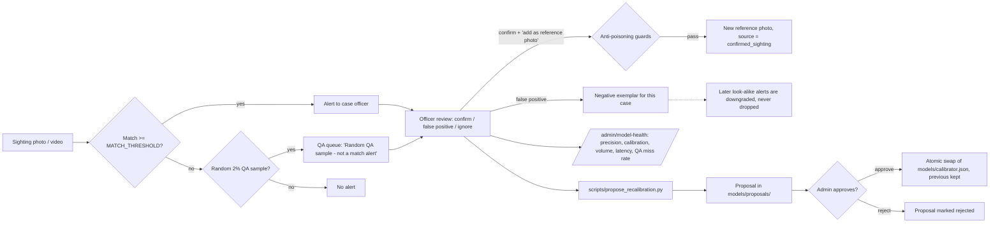

# Human-feedback loop

Every alert is reviewed by an officer. Those decisions are the only ground truth the system gets
from the field, so they are used to *measure* the system, to *propose* changes, and, behind
guards, to *improve* individual cases. Nothing about the global model or thresholds changes
without an Admin's explicit approval.



## What each decision does

| Decision | Effect |
|---|---|
| Confirm match | Counted as a true alert. Optional, off by default: add the face as a reference photo of the case. |
| False positive | Counted as a false alert. The face embedding becomes a **negative exemplar** of that case. |
| Ignore | Not counted either way (for example, unusable image). |
| Confirm on a QA sample | Counted as a **miss**: the system scored the person below the threshold. |

## Template growth guards (anti-poisoning)

A confirmed face is added as a reference photo only when **all** of these hold
(`services/feedback.template_growth_check`):

1. the officer owns the case, or is an Admin;
2. the case has fewer than `MAX_SIGHTING_TEMPLATES` (3) photos that came from sightings;
3. the face passes the quality gate (detector score >= `DET_SCORE_MIN`, width >= `MIN_ENROL_FACE_PX`);
4. its cosine similarity to at least one *enrolment* photo is >= `MATCH_THRESHOLD`, so a stranger
   confirmed by mistake cannot become part of the case.

Every addition is written to the case's audit log and can be deactivated on the case page.
Sighting photos give old cases a recent photo, which directly addresses the age-gap problem
(see "Age gap" in [EVALUATION.md](EVALUATION.md)).

## False-positive suppression

When the same stranger keeps matching a case (a regular at a railway station, a look-alike
relative), the officer marks the first alert as false positive. Later alerts for that case are
**downgraded** to "Needs Review – similar to a previously rejected face" when the probe is at
least `NEG_SUPPRESS_THRESHOLD` (0.6) similar to a rejected face *and* closer to it than to the
case's best photo. They are still shown. The offline simulation on the LFW open-set test split
downgraded 11% of repeat false alerts and 0 true alerts (`eval/results/neg_suppression.json`).

## Field metrics (`/admin/model-health`, Admin only)

- Weekly alert precision = confirmed / (confirmed + false positive), with Wilson 95% intervals.
- Precision and calibration by similarity bucket: observed confirm rate vs the mean estimated
  likelihood shown to officers.
- Alert volume per day vs the alert-load plan in [OPERATING_POINT.md](OPERATING_POINT.md).
- Review latency (alert -> review) and the unreviewed backlog.
- Breakdown by source (image / video) and by face size.
- Any row with fewer than `FIELD_MIN_N` (30) reviews shows "insufficient data", never a percentage.

## Selection bias and the random QA sample

Only faces above the threshold become alerts, so the field data shows false alerts but **never
shows misses**: a missing person whose face scored 0.25 is invisible. Re-fitting on alerts alone
would also only describe scores above the threshold.

Mitigation: `AUDIT_SAMPLE_RATE` (2%) of below-threshold faces with a nearest active case are sent
to that case's officer as "Random QA sample – not a match alert". The share of those that the
officer confirms estimates the miss rate without bias. At 2% this needs many sightings before it
says anything (n >= 30 reviewed samples); until then the page shows "insufficient data".

## Calibration proposals (human-approved, never automatic)

```bash
python scripts/propose_recalibration.py
```

The script needs at least 200 reviewed alerts with at least 30 confirmed and 30 false positives.
It re-fits a Platt curve on the field reviews, cross-validates it, compares it with the current
calibrator and writes `models/proposals/<date>.json`. An Admin approves or rejects it on
`/admin/model-health`. Approval writes the new calibrator atomically (temp file + rename), keeps
the previous file as `models/calibrator.previous_<time>.json` for rollback, and records who
approved it and when (proposal file and audit log). The proposal states its basis: "P(confirmed |
alert, score)", fitted only on above-threshold scores.

Thresholds are not part of this loop. Changing `MATCH_THRESHOLD` needs a new evaluation
(`make eval-all`, then `docs/OPERATING_POINT.md`), and it must never be loosened to fix one subgroup.

## Retention and privacy

- Negative exemplars, random QA samples (row, review and face crop) and stored face embeddings
  of sighting faces are deleted after `RETENTION_DAYS` (90) by `scripts/purge_expired.py`.
  Run it daily, for example:

  ```bash
  15 3 * * *  cd /srv/locatenet && .venv/bin/python scripts/purge_expired.py
  ```

- There is no export of face crops. `scripts/export_feedback.py --admin <user> --out file.jsonl`
  (Admin account and password required) exports embeddings, decisions and metadata only, for
  offline evaluation.
